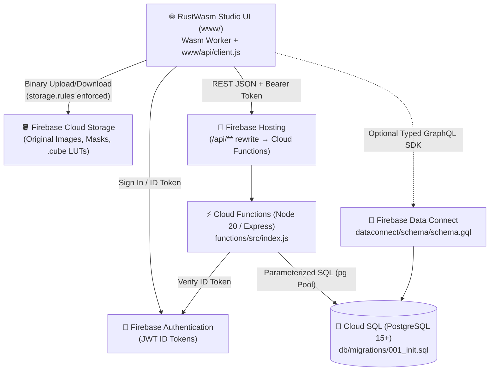
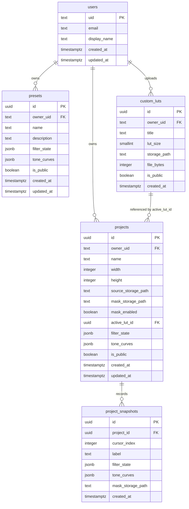

# Firebase SQL & Cloud API Architecture (`db` Branch)

This document specifies the optional cloud persistence backend for **RustWasm Studio**, combining **Firebase Authentication**, **Firebase Cloud Storage**, **Cloud SQL (PostgreSQL)**, **Firebase Data Connect**, and **Cloud Functions for Firebase (Express REST API)**.

> [!NOTE]
> The core Rust + WebAssembly image processing studio (`www/`) remains 100% client-side and works without any backend. This architecture adds optional cloud persistence for projects, painted masks, `.cube` 3D LUTs, presets, and history snapshots.

---

## 1. High-Level Topology



---

## 2. PostgreSQL Schema (`db/migrations/001_init.sql`)



### Design Rationale
- **Binary payloads stay out of SQL**: Large RGBA source images, alpha masks, and `.cube` LUT files live in **Firebase Cloud Storage** under `users/{uid}/...` protected by `storage.rules`. PostgreSQL stores only validated metadata and `storage_path` references.
- **`JSONB` for Filter & Curve State**: `filter_state` stores all studio sliders (including Brightness, Contrast, Saturation, Lens Optics `lensK1`/`caAngle`, and OKLCH `oklchLightness`/`oklchChroma`/`oklchHueRotation`/selective band parameters), while `tone_curves` stores the `master`/`r`/`g`/`b` spline anchor arrays.
- **Dual SQL Access Path**:
  - **REST API** (`functions/`): Express + `pg` + `zod` for custom validation, `/health` checks, and REST clients (`www/api/client.js`).
  - **Firebase Data Connect** (`dataconnect/`): Type-safe GraphQL schema and `@auth(level: USER | PUBLIC)` queries/mutations over the exact same PostgreSQL tables.

---

## 3. REST API Endpoints (`functions/src/`)

| Method | Path | Auth | Purpose |
|---|---|---|---|
| `GET` | `/health` | Public | Verify API & PostgreSQL connectivity |
| `GET` | `/v1/projects` | Bearer Token | List authenticated user's projects |
| `GET` | `/v1/projects/:id` | Bearer Token | Fetch an owned or public project |
| `POST` | `/v1/projects` | Bearer Token | Create project (enforces `users/{uid}/projects/` path ownership) |
| `PATCH` | `/v1/projects/:id` | Bearer Token | Save slider `filterState`, `toneCurves`, mask, or title |
| `DELETE` | `/v1/projects/:id` | Bearer Token | Delete owned project (cascades snapshots) |
| `GET` | `/v1/projects/:id/snapshots` | Bearer Token | List cloud history snapshots |
| `POST` | `/v1/projects/:id/snapshots` | Bearer Token | Push a cloud snapshot mirroring Wasm `HistoryEntry` |
| `GET` | `/v1/presets/public` | Public | Browse shared presets |
| `GET` | `/v1/presets` | Bearer Token | List user's saved presets |
| `POST` | `/v1/presets` | Bearer Token | Save current filter/OKLCH/curve look as preset |
| `DELETE` | `/v1/presets/:id` | Bearer Token | Delete owned preset |
| `GET` | `/v1/luts` | Bearer Token | List owned and public `.cube` LUT records |
| `POST` | `/v1/luts` | Bearer Token | Register `.cube` LUT uploaded to `users/{uid}/luts/` |
| `DELETE` | `/v1/luts/:id` | Bearer Token | Delete owned LUT record |

---

## 4. Setup & Local Emulator Workflow

1. **Install Firebase CLI & dependencies**:
   ```bash
   npm install -g firebase-tools
   cd functions && npm install
   ```
2. **Configure local environment**:
   - Copy `.firebaserc.example` → `.firebaserc` and set your Firebase project ID.
   - Copy `.env.example` → `functions/.env` and set `DATABASE_URL` pointing to local Postgres or Cloud SQL Auth Proxy.
   - Apply the initial migration:
     ```bash
     psql "$DATABASE_URL" -f db/migrations/001_init.sql
     ```
3. **Run Firebase Emulators**:
   ```bash
   firebase emulators:start
   ```
   Emulators run Auth (`:9099`), Functions (`:5001`), Hosting (`:5000`), Storage (`:9199`), Data Connect (`:9399`), and Emulator UI (`:4000`).
